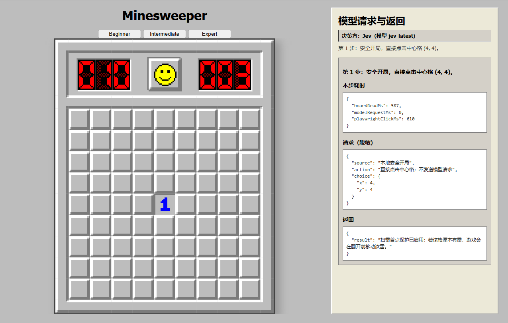
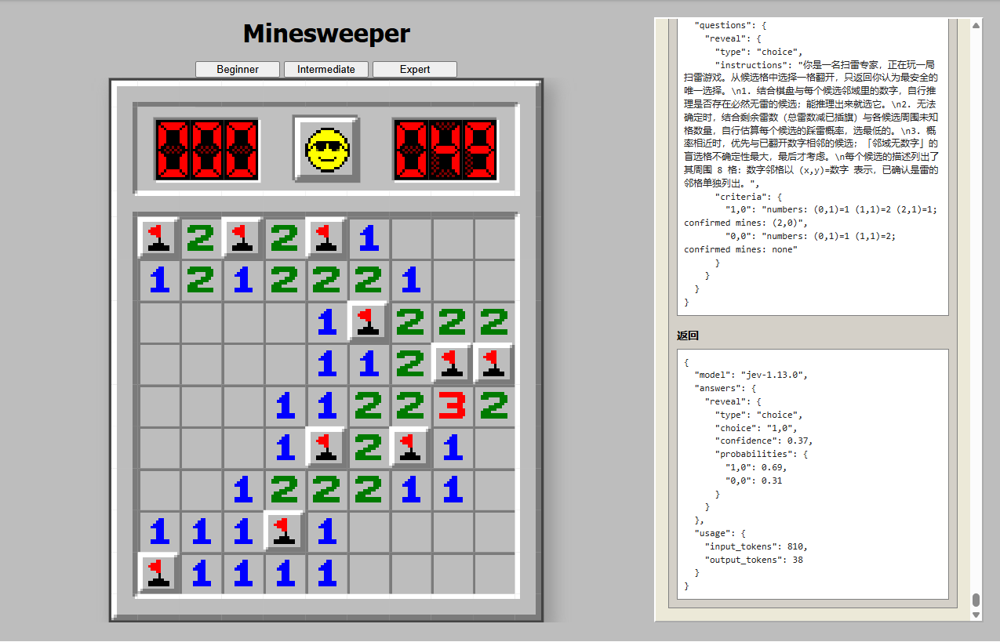

# jev-minesweeper

English | [简体中文](./README.zh-CN.md)

> 🆕 **New · 2026-11-12:** Now supports Google's newly released [Gemini Decisions API](https://blog.google/innovation-and-ai/technology/developers-tools/gemini-decisions-api/) (`gemini-decision-1`), with optional board screenshots for multimodal decisions. Run with `--provider gemini`; add `--gemini-screenshot` to send screenshots too.

An LLM-driven Minesweeper experiment: **Jev**, **Google Gemini Decisions**, or any **OpenAI-compatible model** plays through real Chrome DOM clicks, while the side panel shows every sanitized request and response in real time. All providers receive the same decision instructions, board state, and candidate information; only the API request/output wrappers differ.

| Game start: safe center opening, decision panel on the right | Cleared: sunglasses face, mines auto-flagged, full request log |
| --- | --- |
|  |  |

## Quick start

```bash
npm install
npm install -g @playwright/cli
cp config/providers.example.yaml config/providers.yaml   # fill in openai base_url / model / api_key
node scripts/play-all.mjs --provider openai --level beginner
```

Requires Node.js 22.19+ (the `undici` dependency requirement), Google Chrome, and the global `@playwright/cli` package. The automation drives a real Chrome page through Playwright CLI `click`/`eval` commands.


## Commands

```bash
node scripts/play-all.mjs --provider jev --level beginner      # Jev
node scripts/play-all.mjs --provider openai --level beginner   # OpenAI-compatible model
node scripts/play-all.mjs --provider gemini --level beginner   # Google Gemini Decisions
node scripts/play-all.mjs --provider gemini --gemini-screenshot --level beginner # text + board screenshots
node scripts/play-all.mjs --level beginner                     # use default_provider from the yaml
npm test                                                        # keyless smoke test for all three levels
npm run test:providers                                           # keyless Gemini contract and config tests
node scripts/play-all.mjs --verify --level beginner            # keyless smoke test for one level
```

`--level` accepts `beginner` / `intermediate` / `expert`; omit it to play all three. `--verify` performs one known-safe real DOM click per level and does not call an LLM. A provider run is autonomous: safe center opening, auto-flagging of deduced mines, local click when a single candidate remains, until the game is cleared, a mine explodes, or the step limit is hit. A provider run is probabilistic and is not guaranteed to win every game.

On the page, selecting a level only highlights it and prepares an idle board; it does not start the timer. Click **Replay** to start the selected level. During the review wait, **Replay** starts another game at the currently selected level.

If a previous run was interrupted, the fixed Playwright session may still be open. The normal command now closes that stale session automatically; use `--reuse-session` only when intentionally continuing an existing browser session.

## Configuration — config/providers.yaml

| Key | Meaning |
| --- | --- |
| `default_provider` | `jev`, `openai`, or `gemini`; the `--provider` flag wins |
| `jev.endpoint` / `model` / `api_key` | With an empty key, the env vars `TYPESAFE_API_KEY` and `JEV_API_KEY` are used |
| `openai.base_url` / `model` / `api_key` | Any OpenAI-compatible endpoint; `api_key` may alternatively point at an env var via `api_key_env` |
| `openai.temperature` / `json_mode` | Default 0 / true (`json_mode: false` for endpoints without `response_format` support) |
| `gemini.endpoint` / `model` / `api_key` | Google `/v1beta/decisions` with `gemini-decision-1` by default; an empty key reads `GEMINI_API_KEY`, then `GOOGLE_API_KEY` |
| `gemini.api_key_env` | Custom key environment variable, default `GEMINI_API_KEY`; YAML `api_key` wins |
| `gemini.include_screenshot` | Default `false`; initial state of the page's screenshot checkbox (`--gemini-screenshot` enables it on startup) |
| `request.attempts` / `proxy` | Network retries and proxy; `JEV_REQUEST_ATTEMPTS`, `JEV_PROXY`, `HTTPS_PROXY` env vars take precedence |

### Google Gemini Decisions

Existing `providers.yaml` files work without a Gemini section: the default endpoint and model are filled in automatically. In PowerShell:

```powershell
$env:GEMINI_API_KEY = "your Google AI Studio API key" # omit if GOOGLE_API_KEY is already set
node scripts/play-all.mjs --provider gemini --level beginner
```

You can also set `default_provider: gemini` or copy the template's `gemini` section to customize it. The provider calls the [official Decisions REST API](https://aistudio.google.com/docs/decisions-api) through the shared HTTP transport, without another SDK. The board is serialized as JSON text in `input`, candidates become options in a `choice` question, and the key is sent only in the `x-goog-api-key` header. The key's Google project needs access to the model and available quota.

Screenshots are **off by default**. Enable **Send board screenshot to Gemini** on the page, set `gemini.include_screenshot: true` in YAML, or start with `--gemini-screenshot`. The page checkbox is read before every Gemini decision, so changes apply to the next request and remain in effect across Replay. YAML/CLI settings set its initial state and are reapplied after a page reload.

When enabled, Playwright captures the current cell grid after auto-flagging and before revealing the selected cell. The crop includes every cell along all four edges, excluding the timer, face, level buttons, logs, and other screen areas. The current cells' visible sprite pixels are copied onto an in-memory canvas at native resolution and the PNG dimensions are checked. Capture leaves the page layout, scale, and scroll position unchanged, preventing flicker. The request contains both the existing text state and a PNG `image` block with Base64 `data`, `mime_type: image/png`, and `resolution: high`, following the [official image input format](https://aistudio.google.com/docs/decisions-api#media). Each PNG is saved under `result/` and previewed in the decision panel; JSON logs contain its path and byte count, with Base64 omitted. Local opening and single-candidate clicks do not send a model request or capture a screenshot. The switch applies to Gemini only.

Gemini Decisions appears in the page dropdown when a key is configured; select it for the next Replay. Requests, responses, probabilities, model names, and timings use the existing logs. Google's `confidence` describes certainty in the winning option, not the probability that the cell is safe; `JEV_MIN_CONFIDENCE` checks that returned value. Each choice question accepts 2–255 candidates (the default candidate limit stays 12). A single remaining candidate is clicked locally.

### Jev model versions

`jev.model` accepts an alias or an exact version:

| Value | Resolves to |
| --- | --- |
| `jev-latest` | Newest **stable** release, currently `jev-1.13.0` |
| `jev-preview` | Newest release including previews, currently `jev-1.14.0` |
| `jev-1.13.0` / `jev-1.14.0` | Pinned version; does not drift with server-side aliases |

Note: the version shown on the page and in reports comes from the server's response (`response.model`) — the version that actually handled the call — not from the alias written locally, so seeing 1.13.0 while using `jev-latest` is expected. In practice 1.13 and 1.14 play about the same: neither minesweeps well yet, and bumping the model version brings no clear improvement for now.

## Environment variables

```bash
JEV_MAX_STEPS=800            # model turn cap; by default a game is played to completion
JEV_MIN_CONFIDENCE=0.2      # abort below this confidence
JEV_CANDIDATE_LIMIT=12      # candidates offered per turn
JEV_REVIEW_MS=0             # wait for Replay until the browser is closed; a positive value limits this wait
```

## Outputs
- `artifacts/run-report.json`: per-level provider, result (cleared / mine / stopped) and timings.
- `result/jev-<timestamp>.json`: the full sanitized request and response of every turn (never contains keys).
- `result/board-<timestamp>-<index>.png`: board screenshots sent to Gemini when the screenshot switch is enabled.

The `--verify` console result is reported as `verified (1 safe click)`; it is not a completed game result.

## Acknowledgments

The game code in this project was imported from [ziebelje/minesweeper](https://github.com/ziebelje/minesweeper) (by Jon Ziebell), with the LLM automation layer built on top. Thank you!
