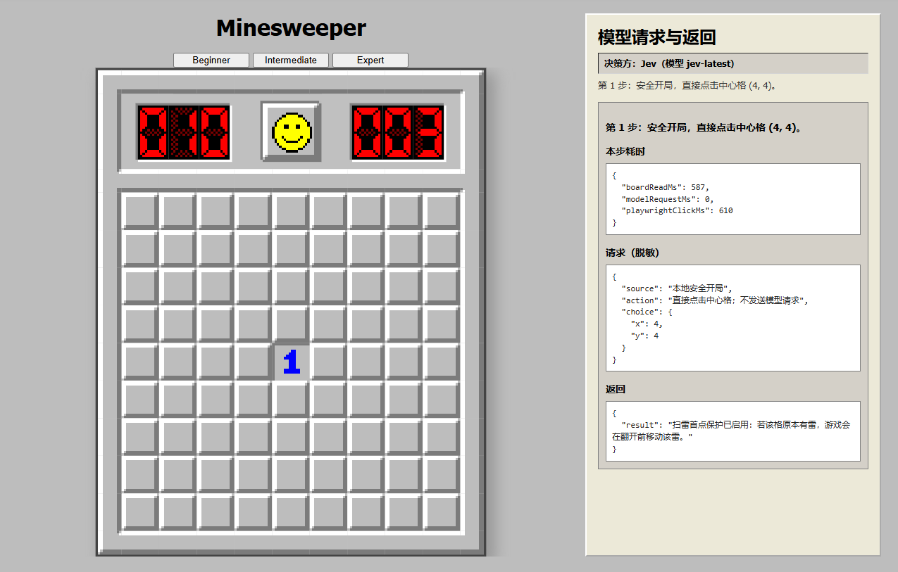
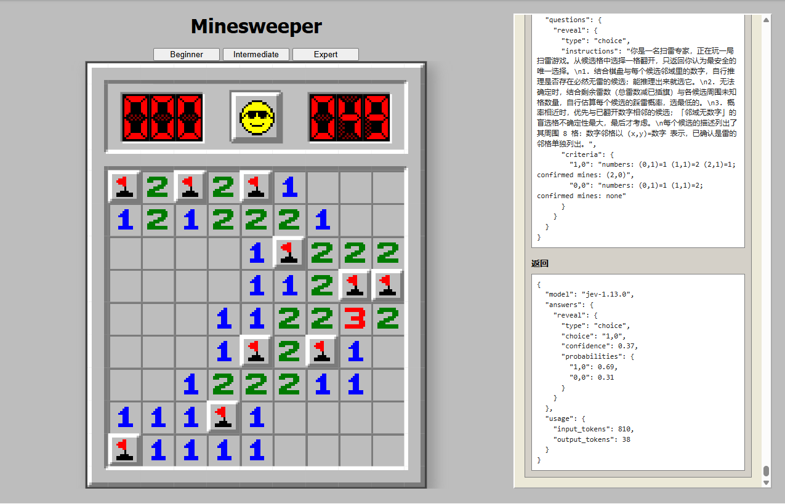

# jev-minesweeper

[English](./README.md) | 简体中文

这是一个 LLM 扫雷实验项目：由 **Jev**、**Google Gemini Decisions** 或任意 **OpenAI 兼容模型** 通过真实 Chrome DOM 点击对局，页面右侧实时显示每一步的脱敏请求与返回。所有决策方共享相同的决策指令、棋盘状态和候选信息，但分别适配各自的 API 请求与输出格式。

| 对局开始：中心安全开局，右侧为决策面板 | 通关：墨镜脸、自动插旗、完整请求记录 |
| --- | --- |
|  |  |

## 快速开始

```bash
npm install
npm install -g @playwright/cli
cp config/providers.example.yaml config/providers.yaml   # 填入 openai 的 base_url / model / api_key
node scripts/play-all.mjs --provider openai --level beginner
```

需要 Node.js 22.19+（`undici` 依赖的版本要求）、Google Chrome 与全局 `@playwright/cli`。自动化通过 Playwright CLI 的 `click`/`eval` 操作真实 Chrome 页面。


## 常用命令

```bash
node scripts/play-all.mjs --provider jev --level beginner      # Jev 对局
node scripts/play-all.mjs --provider openai --level beginner   # OpenAI 兼容接口对局
node scripts/play-all.mjs --provider gemini --level beginner   # Google Gemini Decisions 对局
node scripts/play-all.mjs --level beginner                     # 使用 yaml 里的 default_provider
npm test                                                        # 无密钥冒烟，验证三个等级
npm run test:providers                                           # 无密钥验证 Gemini 请求、响应和配置
node scripts/play-all.mjs --verify --level beginner            # 无密钥冒烟，只验证一个等级
```

`--level` 可选 `beginner` / `intermediate` / `expert`，省略则三个等级连打。`--verify` 每个等级只执行一次已知安全的真实 DOM 点击，不调用模型。正式 provider 对局会自动中心开局、给推导出的确定雷插旗、在只剩一个候选时本地直选，直到通关、踩雷或达到步数上限；模型决策具有概率性，不保证每局通关。

页面中点击等级只会选中并准备一个未开始的棋盘，不会启动计时；点击 **Replay** 才会开始当前选中的等级。等待期间再次点击 **Replay**，会从当前选中的等级重新开始。

如果上次运行被中断，固定的 Playwright 会话可能仍停留在旧页面。普通命令现在会自动关闭旧会话；只有确实要继续已有浏览器会话时才使用 `--reuse-session`。

## 配置 config/providers.yaml

| 配置 | 说明 |
| --- | --- |
| `default_provider` | `jev`、`openai` 或 `gemini`，命令行 `--provider` 优先 |
| `jev.endpoint` / `model` / `api_key` | 密钥留空时读环境变量 `TYPESAFE_API_KEY`、`JEV_API_KEY` |
| `openai.base_url` / `model` / `api_key` | 任意 OpenAI 兼容端点；`api_key` 也可用 `api_key_env` 指向环境变量 |
| `openai.temperature` / `json_mode` | 默认 0 / true（`json_mode: false` 适配不带 `response_format` 的端点） |
| `gemini.endpoint` / `model` / `api_key` | 默认调用 Google `/v1beta/decisions`，模型 `gemini-decision-1`；密钥留空读取 `GEMINI_API_KEY`，再回退到 `GOOGLE_API_KEY` |
| `gemini.api_key_env` | 可指定其他密钥环境变量，默认 `GEMINI_API_KEY`；YAML `api_key` 优先 |
| `request.attempts` / `proxy` | 网络重试次数与代理；`JEV_REQUEST_ATTEMPTS`、`JEV_PROXY`、`HTTPS_PROXY` 等环境变量优先 |

### Google Gemini Decisions

已有的 `providers.yaml` 无需补充 Gemini 配置，程序会自动使用默认端点和模型。在 PowerShell 中运行：

```powershell
$env:GEMINI_API_KEY = "你的 Google AI Studio API 密钥" # 已有 GOOGLE_API_KEY 时可省略
node scripts/play-all.mjs --provider gemini --level beginner
```

也可在 YAML 中设置 `default_provider: gemini`，或复制模板中的 `gemini` 配置段来自定义。程序通过共享的 HTTP 传输直接调用 [Google 官方 Decisions REST API](https://aistudio.google.com/docs/decisions-api)，无需额外 SDK；棋盘作为 JSON 文本传入 `input`，候选格作为 `choice` 问题的选项，密钥仅在 `x-goog-api-key` 请求头中发送。使用该接口需要密钥所属项目有相应的模型访问权限和配额。

页面下拉框会显示已配置密钥的 Gemini Decisions，可在下一次 Replay 切换使用；请求、返回、概率、模型名与耗时沿用现有日志。Google 的 `confidence` 表示选项获胜的置信度，不等于该格无雷的概率；`JEV_MIN_CONFIDENCE` 按该返回值检查。每个 `choice` 问题支持 2–255 个候选格，默认候选上限仍为 12；只剩一个候选时本地直接点击。

### Jev 模型版本

`jev.model` 可以填别名或写死具体版本号：

| 写法 | 指向 |
| --- | --- |
| `jev-latest` | 最新**稳定**版，目前是 `jev-1.13.0` |
| `jev-preview` | 最新版（含预览版），目前是 `jev-1.14.0` |
| `jev-1.13.0` / `jev-1.14.0` | 写死具体版本，行为不随官方别名漂移 |

注意：页面与报告里显示的版本号来自服务端响应回传的实际版本（`response.model`），而不是本地配置里写的别名——所以用 `jev-latest` 时显示 1.13.0 属正常现象。实测 1.13 与 1.14 的扫雷表现基本相同，都还无法很好地完成扫雷，升级模型版本暂时不会带来明显改善。

## 可调环境变量

```bash
JEV_MAX_STEPS=800            # 模型步数上限，默认打完整局
JEV_MIN_CONFIDENCE=0.2      # 置信度下限，低于即终止
JEV_CANDIDATE_LIMIT=12      # 每步交给模型的候选数
JEV_REVIEW_MS=0             # 等待 Replay 直到手动关闭浏览器；正数可限制等待时长
```

## 输出
- `artifacts/run-report.json`：每局 provider、结果（cleared / mine / stopped）与耗时。
- `result/jev-时间戳.json`：每一步的完整脱敏请求与返回（不含任何密钥）。

`--verify` 的终端结果会显示为 `verified (1 safe click)`，表示点击链路验证成功，不代表完成了一局扫雷。

## 致谢

本项目的游戏代码导入自 [ziebelje/minesweeper](https://github.com/ziebelje/minesweeper)（作者 Jon Ziebell），在此基础上加入了 LLM 自动化，在此感谢原作者。
